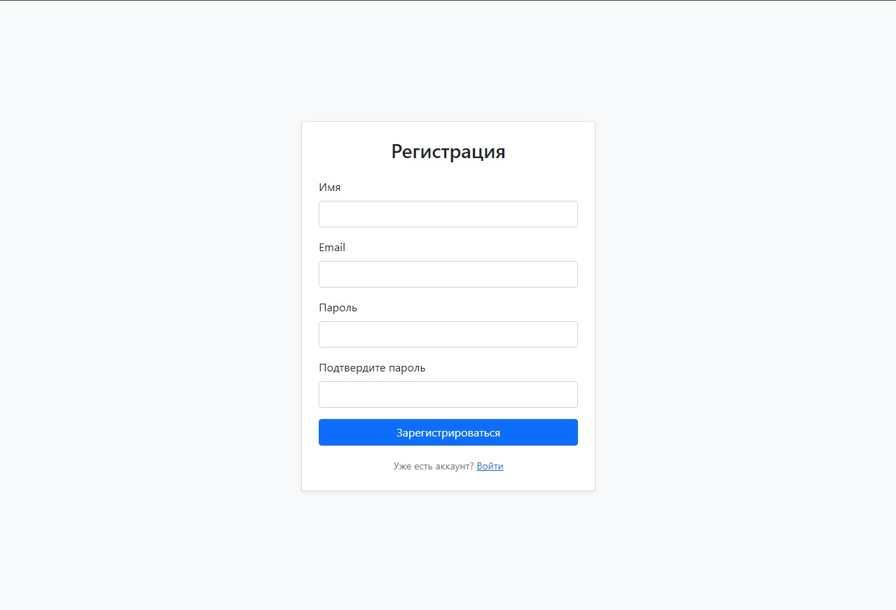
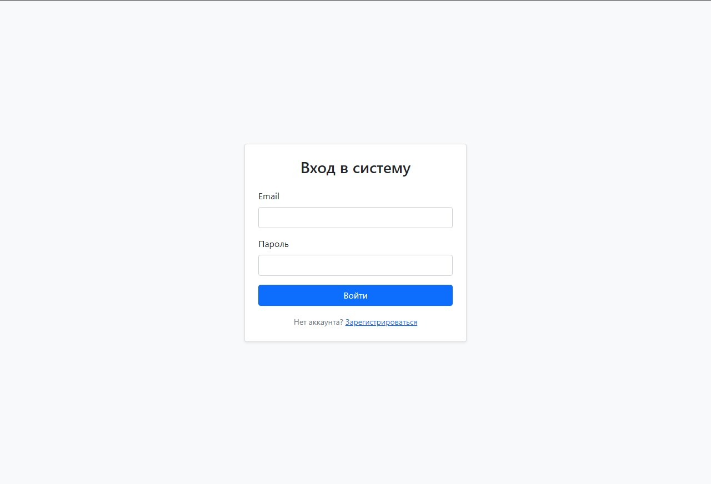
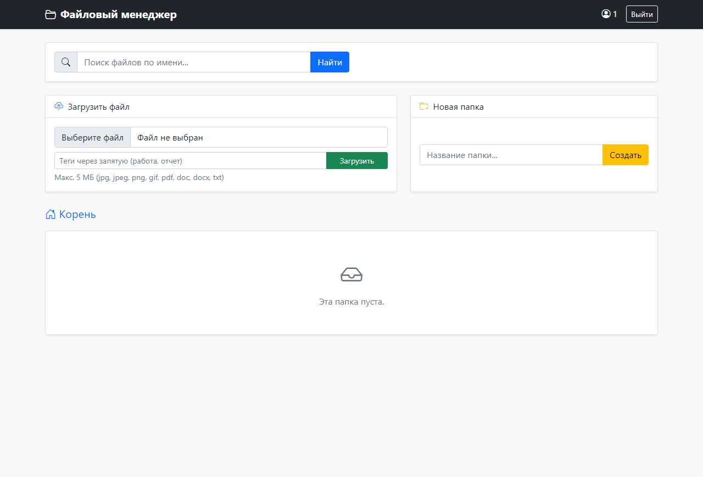
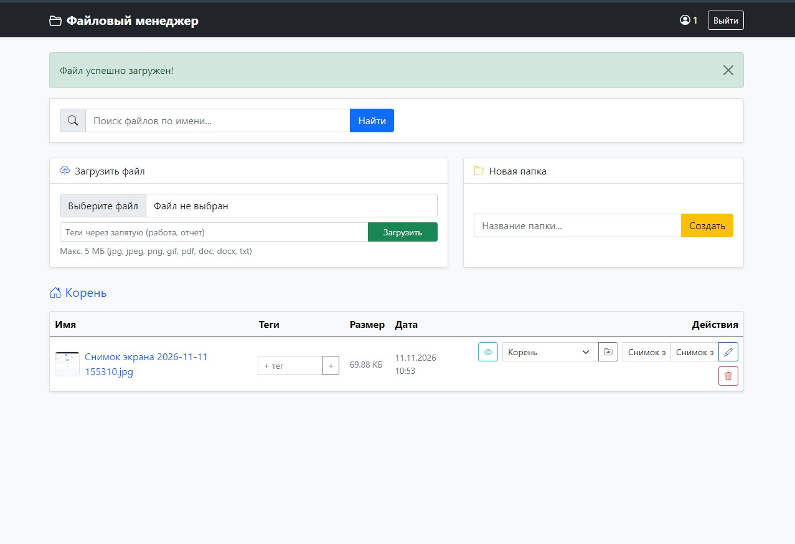
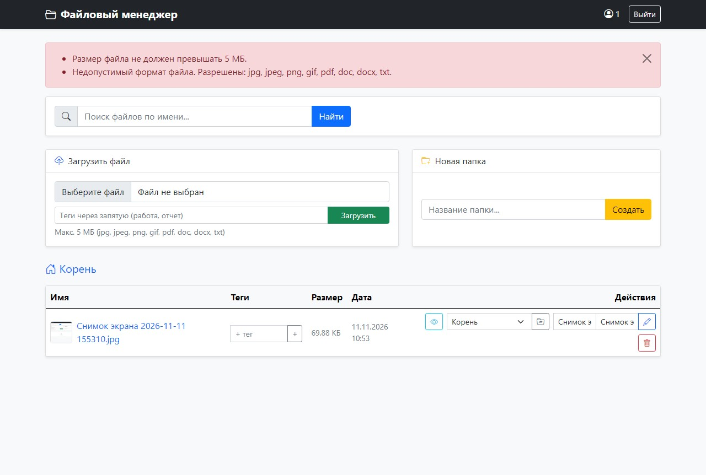
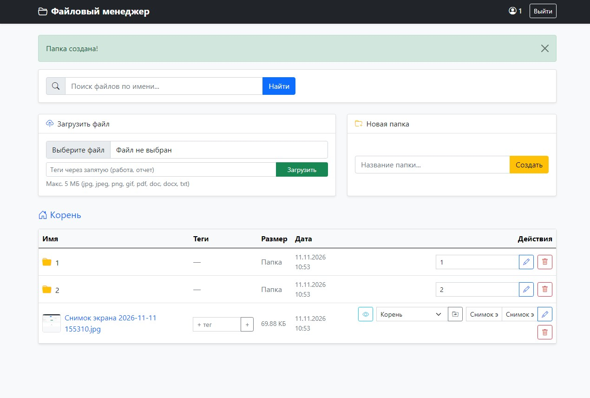
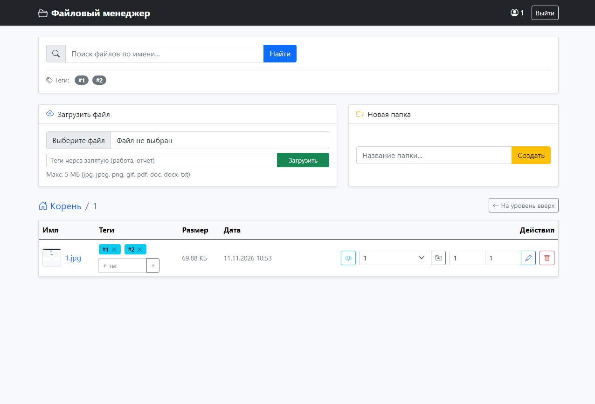
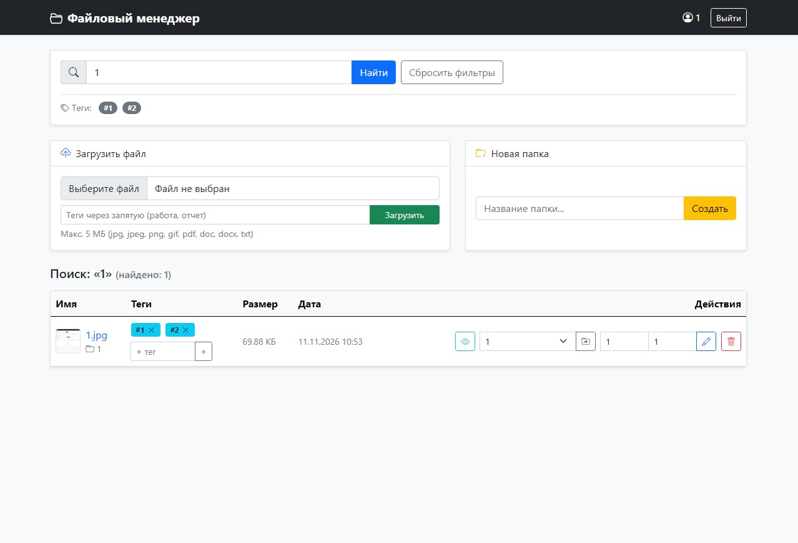

# Файловый менеджер на Laravel

Веб-приложение файлового менеджера, разработанное на фреймворке Laravel. Приложение предоставляет пользователям личное облачное хранилище для удобной загрузки, организации, поиска и управления файлами на сервере.

## Основной функционал

* **Аутентификация пользователей:** регистрация новых пользователей, вход и выход из системы. Каждый пользователь изолирован и видит только свои файлы и папки.
* **Загрузка файлов:** загрузка изображений и документов (`jpg`, `jpeg`, `png`, `gif`, `pdf`, `doc`, `docx`, `txt`) с ограничением максимального размера до 5 МБ.
* **Работа с файлами:** просмотр списка файлов, переименование с сохранением расширения, скачивание по клику на имя и удаление с диска и из базы данных.
* **Предпросмотр изображений:** быстрый просмотр загруженных изображений в модальном окне прямо на странице.
* **Структура папок:** создание папок (включая вложенные директории), навигация с помощью «хлебных крошек», переименование и удаление папок вместе со всем содержимым.
* **Перемещение файлов:** удобный перенос файлов между папками и корневой директорией.
* **Поиск:** мгновенный поиск файлов по имени по всем папкам пользователя.
* **Тегирование:** добавление тегов при загрузке или к уже существующим файлам, удаление тегов и фильтрация списка по выбранному тегу.

## Стек технологий

* **Backend:** PHP 8.x, Laravel
* **База данных:** MySQL / SQLite
* **Frontend:** Blade Templates, Bootstrap 5, Bootstrap Icons

## Установка и запуск проекта локально

1. Клонируйте репозиторий:
   ```bash
   git clone https://github.com
   cd ИМЯ_РЕПОЗИТОРИЯ
   ```

2. Установите зависимости Composer:
   ```bash
   composer install
   ```

3. Создайте файл конфигурации `.env` и сгенерируйте ключ приложения:
   ```bash
   cp .env.example .env
   php artisan key:generate
   ```

4. Настройте подключение к базе данных в файле `.env` и выполните миграции:
   ```bash
   php artisan migrate
   ```

5. Создайте символическую ссылку для публичного хранилища файлов:
   ```bash
   php artisan storage:link
   ```

6. Запустите локальный сервер разработки:
   ```bash
   php artisan serve
   ```

## Скриншоты

### 1.


### 2.


### 3.


### 4.


### 5.


### 6.


### 7.


### 8.

