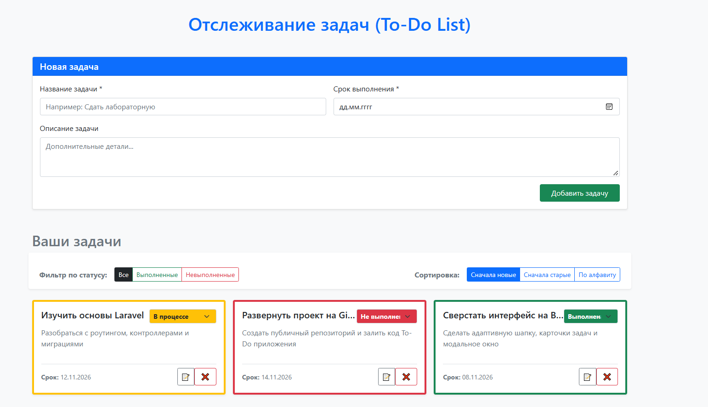
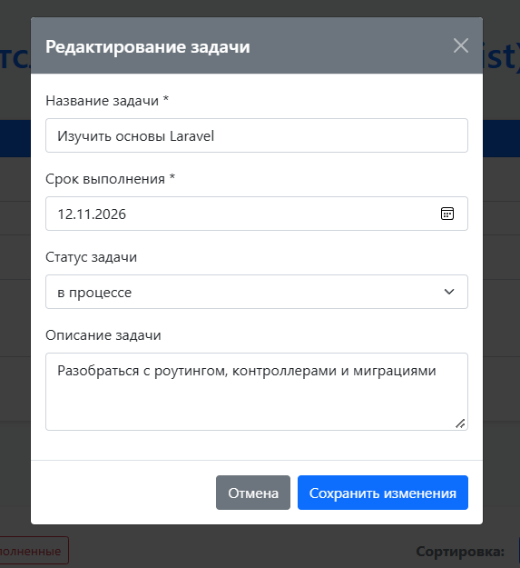

# Веб-приложение для отслеживания задач (To-Do List)

Современный и адаптивный таск-менеджер, разработанный на фреймворке **Laravel** с использованием фронтенд-фреймворка **Bootstrap**. Приложение реализует полный цикл управления задачами (CRUD), фильтрацию, сортировку, а также содержит функции логирования и отладки ошибок.

# 📸 Скриншоты проекта





***

## ✨ Основные функции приложения

### 1. Управление задачами (CRUD)
* **Создание:** Удобная форма для добавления новых задач. Пользователь вводит название, детальное описание и указывает срок выполнения. Входные данные проходят строгую валидацию (название и дата обязательны).
* **Чтение:** Все созданные задачи отображаются на главной странице в виде аккуратных и информативных карточек. Каждая карточка визуально подсвечивается определенным цветом в зависимости от её текущего статуса.
* **Обновление:** Возможность полного редактирования названия, описания и дедлайна задачи внутри интерактивного модального окна (Bootstrap Modal).
* **Удаление:** Безопасное удаление задач с предварительным подтверждением действия в браузере для предотвращения случайных нажатий.

### 2. Сортировка и Фильтрация
* **Фильтр по статусу:** Возможность мгновенно переключаться между вкладками для отображения всех задач, только выполненных или только невыполненных.
* **Гибкая сортировка:** Сортировка текущего списка задач по алфавиту (от А до Я), по дате добавления (сначала новые) или в обратном порядке (сначала старые). Фильтры и сортировка могут работать одновременно.

### 3. Быстрое управление статусами
* В каждую карточку встроен интерактивный выпадающий список (*выполнена, в процессе, не выполнена*). Изменение статуса происходит «на лету» без необходимости открывать форму редактирования — страница обновляется автоматически сразу после выбора нового значения.

### 4. Логирование и Дебаг
* Все ключевые действия (создание задачи, изменение её полей, обновление статуса или удаление) автоматически протоколируются в системный лог фреймворка (`storage/logs/laravel.log`) с фиксацией ID и названий сущностей.
* Настроена глобальная обработка исключений. В случае возникновения ошибок или ввода несуществующего адреса, приложение корректно обрабатывает дебаг-функции, не нарушая общую работоспособность интерфейса.

---

## 🎨 Дизайн и Адаптивность
* Интерфейс полностью построен на базе **Bootstrap 5**.
* Дизайн является адаптивным и одинаково корректно отображается как на мониторах ПК, так и на экранах мобильных телефонов (использована концепция Grid-сетки `row` / `col`).
* Статусы задач имеют цветовую дифференциацию для быстрого считывания информации (Зеленый — выполнено, Желтый — в процессе, Красный — не выполнено).

---

## 🛠 Технологический стек
* **Backend:** PHP 8.2+ / Laravel (MVC)
* **Frontend:** Blade, Bootstrap 5, JavaScript (Vanilla JS)
* **Database:** MySQL / PostgreSQL / SQLite

---

## 🚀 Как запустить проект локально

1. **Клонируйте репозиторий с GitHub:**
   ```bash
   git clone <ссылка_на_репозиторий>
   cd <название_папки_проекта>
   ```

2. **Установите все PHP-зависимости через Composer:**
   ```bash
   composer install
   ```

3. **Создайте файл конфигурации окружения:**
   ```bash
   cp .env.example .env
   ```
   *Задайте настройки вашей базы данных в появившемся файле `.env` (строки `DB_DATABASE`, `DB_USERNAME`, `DB_PASSWORD`).*

4. **Сгенерируйте уникальный ключ приложения:**
   ```bash
   php artisan key:generate
   ```

5. **Выполните миграции базы данных и запустите сидер для наполнения тестовыми задачами:**
   ```bash
   php artisan migrate:fresh --seed
   ```

6. **Запустите локальный сервер разработки:**
   ```bash
   php artisan serve
   ```
   *После этого приложение станет доступно в браузере по адресу: `http://127.0.0.1:8000`*

---